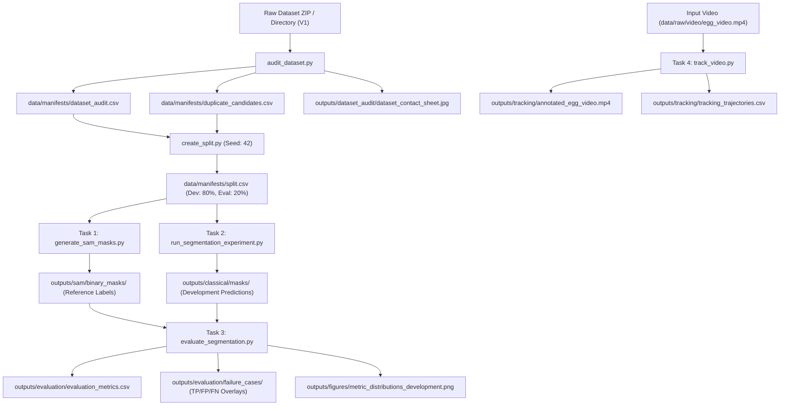

# eggcv Architecture & System Design

## 1. Overview
The `eggcv` codebase is designed for modularity, reproducibility, and leakage-proof computer vision pipelines. It addresses the four tasks of the Nosh Robotics Computer Vision Intern assignment:
1. **Task 1: Pretrained Segmentation** — Meta Segment Anything Model (SAM) reference mask generation.
2. **Task 2: Classical Image Processing** — Classical CV egg segmentation using OpenCV, color-space analysis, morphology, and geometric shape filtering.
3. **Task 3: Evaluation & Error Analysis** — Quantitative metrics (IoU, Dice, Precision, Recall) and qualitative failure case galleries.
4. **Task 4: Video Tracking** — Persistent multi-object egg tracking and trajectory logging on video.

---

## 2. Package Architecture (`src/eggcv/`)

```
eggcv/
├── common/             # Reusable foundation
│   ├── io.py           # Robust image/mask read & write (cv2.imdecode/imencode, YAML)
│   ├── visualization.py # Mask overlays, error maps (TP/FP/FN), contact sheets
│   └── logging_utils.py# Structured console and file logging
│
├── dataset/            # Data integrity & leakage prevention
│   ├── inspect_dataset.py     # ZIP/directory audit, image verification, statistics
│   ├── duplicate_detection.py # SHA-256 exact & perceptual (dHash/aHash/pHash) hashing & DSU grouping
│   └── create_split.py        # 80:20 zero-leakage development/evaluation partitioning
│
├── segmentation/       # Segmentation algorithms
│   ├── classical_segmenter.py # Modular ClassicalEggSegmenter with configurable stages
│   ├── sam_segmenter.py       # Official Meta SAM ViT-B wrapper & proposal filtering
│   └── morphology.py          # Morphological cleaning, hole filling, component priors, watershed
│
├── evaluation/         # Metrics & benchmarking
│   ├── metrics.py      # IoU, Dice, Precision, Recall with explicit empty-mask policies
│   ├── evaluate.py     # Split-aware batch evaluation engine
│   └── error_analysis.py # Failure case extraction, visual error maps, distribution plots
│
└── tracking/           # Temporal tracking & video processing
    ├── association.py  # Pairwise centroid distance matrix & Hungarian matching
    ├── tracker.py      # Multi-object EggTracker with persistent ID management
    └── video_pipeline.py # VideoCapture, frame processing, overlay annotations, VideoWriter
```

---

## 3. Data Flow



---

## 4. Design Principles
- **Separation of Parameters from Code**: All critical hyperparameters (thresholds, kernel sizes, association radii, paths) reside in YAML files in `configs/`.
- **Zero Leakage Guarantee**: Exact duplicates and near-duplicates (perceptual Hamming distance $\le 6$) are grouped using Disjoint Set Union (DSU). No group ever spans the development and evaluation boundary.
- **Fail-Fast Error Handling**: File missing or corrupted images raise explicit, descriptive exceptions rather than silently swallowing errors or returning `None`.
- **No Machine-Specific Hardcoded Paths**: All scripts resolve paths relative to the project root directory.
